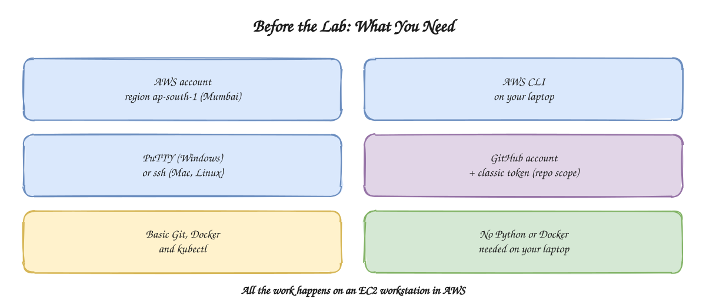

# Before the Lab: What You Need

Diagram source: [Excalidraw](../02-diagrams/excalidraw/prerequisites-for-the-lab.excalidraw) | draw.io: [python-production-engineering.drawio](../02-diagrams/drawio/python-production-engineering.drawio), page 10

## Context

Everything in this course happens in AWS. Your laptop is only a window into it.
That is good news: you do not need a powerful laptop, and you do not need Python, Docker or Kubernetes installed on it.

## What you need

| Item | Why |
|------|-----|
| AWS account, region ap-south-1 (Mumbai) | Every resource in the lab is created here |
| AWS CLI on your laptop | To create the network and the workstation |
| PuTTY (Windows) or ssh (Mac, Linux) | To log in to the EC2 workstation |
| GitHub account and a classic token with `repo` scope | To push your code |
| Basic Git, Docker and kubectl | We use them as tools. This is not a Docker or Kubernetes course |
| A browser with https://app.diagrams.net | To open the course diagrams |

## Concept: the EC2 workstation

Laptops are all different: Windows, Mac, 8 GB RAM, office proxies. An EC2 instance is the same for everyone, sits inside AWS next to ECR and EKS, and gets AWS permissions from an IAM role instead of access keys.
Your laptop creates the network and the workstation. After that, all the work happens on the workstation.

## Concept: cost

EKS, its two worker nodes and the load balancer cost money every hour. Finish the lab and run the clean up (Part 14) the same day.

## In the lab

Part 00 checks your laptop. Parts 01 and 02 create the network and the workstation.

## Interview questions

1. Why build on an EC2 workstation instead of your laptop?
2. Why does the workstation use an IAM role instead of access keys?

[Theory index](README.md) | Next: [From Python Code to a Production Service](01-python-code-to-production-service.md)

## Keep learning

- YouTube: https://www.youtube.com/@BuildAutomateArchitect
- System Design playlist: https://www.youtube.com/playlist?list=PLeAHTLMwFYQ0
- Telegram: https://t.me/BuildAutomateArchitect
- Website: https://rahulchaubeyconsulting.com/
