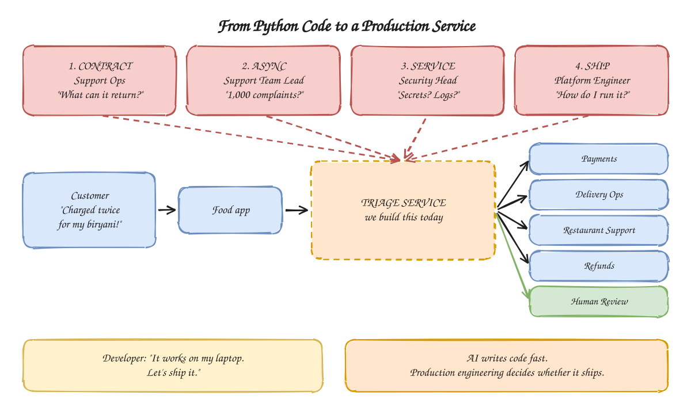

# From Python Code to a Production Service

Diagram source: [Excalidraw](../02-diagrams/excalidraw/page-01-python-code-to-production-service.excalidraw) | draw.io: [python-production-engineering.drawio](../02-diagrams/drawio/python-production-engineering.drawio), pages 01 and 01b

## Context

It is Friday night. It is raining, there is an IPL match, and nobody wants to cook. Orders spike on our Zomato style food app, and so do complaints:

- "My card was charged twice for my biryani."
- "My delivery is 50 minutes late."
- "There is a problem with my restaurant order."

Each complaint must reach the right team: Payments, Delivery Ops, Restaurant Support or Refunds. Today a person reads every complaint and decides. On a Friday night, that does not scale.

## Concept: triage

Triage means sorting. We do not solve the complaint. We decide three things and pass it on:

    category: payments
    priority: 4
    team:     payments

If the answer cannot be trusted, the complaint goes to **Human Review**. Nothing is lost.

## Concept: the four gates

A developer builds the first version with an AI coding assistant in 30 minutes and says: "It works on my laptop. Let's ship it." Four people say NO:

| Gate | Who says NO | Their question |
|------|-------------|----------------|
| 1. CONTRACT | Head of Support Ops | What exactly can this service return? |
| 2. ASYNC | Support Team Lead | Thousands of complaints, and we wait on another system? |
| 3. SERVICE | Security Head | Where are your secrets? Why is customer data in the logs? |
| 4. SHIP | Platform Engineer | How am I going to run this? |

AI writes code fast. Production engineering decides whether it ships.

## Concept: the ship path

    Python prototype -> API -> Contract -> Async -> Config + Secrets -> Logging + Health checks -> Docker -> ECR -> EKS

One application, built step by step. Every step answers one of the four NOs.

## In the lab

The whole lab is this page, built for real. Start with the [lab map](../03-labs/README.md).

## Interview questions

1. What is the difference between a Python script and a production service?
2. Name the four gates and the question each one answers.
3. Why is "it works on my laptop" not enough?

Previous: [Before the Lab: What You Need](00-prerequisites-for-the-lab.md) | [Theory index](README.md) | Next: [API and HTTP: How Two Systems Talk](02-api-and-http.md)

## Keep learning

- YouTube: https://www.youtube.com/@BuildAutomateArchitect
- System Design playlist: https://www.youtube.com/playlist?list=PLeAHTLMwFYQ0
- Telegram: https://t.me/BuildAutomateArchitect
- Website: https://rahulchaubeyconsulting.com/
