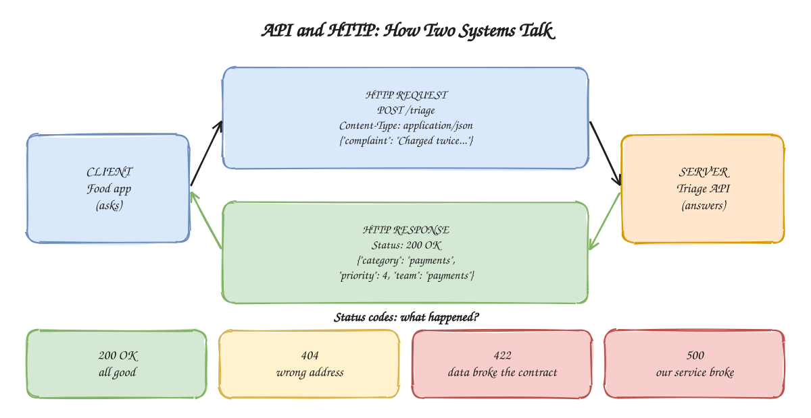

# API and HTTP: How Two Systems Talk

Diagram source: [Excalidraw](../02-diagrams/excalidraw/page-02-api-and-http.excalidraw) | draw.io: [python-production-engineering.drawio](../02-diagrams/drawio/python-production-engineering.drawio), page 02

## Context

The food app and our Triage Service are two separate programs, maybe written by two different teams. How does the app hand a complaint to our service and get an answer back?

## Concept: API

An API is the **boundary** between two systems. The food app only needs to know: "send a complaint in THIS format, get a result back in THAT format". It does not care how we decide.

## Concept: HTTP request and response

    Request                                   Response
    POST /triage                              200 OK
    {"complaint": "My card was charged        {"category": "payments",
     twice for my biryani."}                   "priority": 4, "team": "payments"}

- **Endpoint**: where (`/triage`)
- **Method**: what kind of action (`POST` = process this)
- **Body**: the data, as JSON

## Concept: methods and status codes

| Method | Meaning |
|--------|---------|
| GET | give me something (our `/healthz`) |
| POST | process this (our `/triage`) |
| PUT / PATCH | change something |
| DELETE | remove something |

| Code | Meaning |
|------|---------|
| 200 | it worked |
| 400 | the client sent something wrong |
| 404 | no such endpoint |
| 422 | the data failed the contract |
| 500 | the server had a problem |

4xx means the caller must fix something. 5xx means we must fix something.

## In the lab

Every `curl` in the lab is an HTTP request. In Part 09 you send a good complaint (200) and a bad one (422).

## Interview questions

1. What happens when the food app calls our API? Walk through request and response.
2. GET versus POST: why is /triage a POST?
3. 4xx versus 5xx: who has to fix the problem?

Previous: [From Python Code to a Production Service](01-python-code-to-production-service.md) | [Theory index](README.md) | Next: [FastAPI and Uvicorn: Turning Python Code into a Service](03-fastapi-and-uvicorn.md)

## Keep learning

- YouTube: https://www.youtube.com/@BuildAutomateArchitect
- System Design playlist: https://www.youtube.com/playlist?list=PLeAHTLMwFYQ0
- Telegram: https://t.me/BuildAutomateArchitect
- Website: https://rahulchaubeyconsulting.com/
