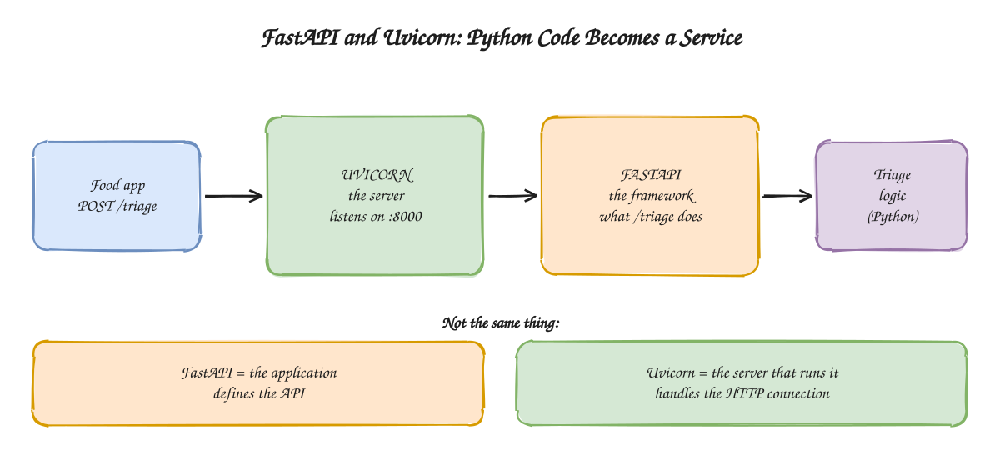

# FastAPI and Uvicorn: Turning Python Code into a Service

Diagram source: [Excalidraw](../02-diagrams/excalidraw/page-03-fastapi-and-uvicorn.excalidraw) | draw.io: [python-production-engineering.drawio](../02-diagrams/drawio/python-production-engineering.drawio), page 03

## Context

Our triage logic is a Python function. The food app cannot call a Python function over the network. We need something that listens for HTTP and hands the request to our code.

## Concept: two different jobs

| Piece | Job |
|-------|-----|
| **Uvicorn** | the server: opens a port, accepts HTTP connections |
| **FastAPI** | the framework: decides what happens when `/triage` is called |

    Food app -> Uvicorn (port 8000) -> FastAPI (POST /triage) -> our triage code -> response

FastAPI is not a server, and Uvicorn does not know anything about complaints. Together they turn a Python program into an HTTP service.

## Concept: free API documentation

FastAPI reads our code and writes interactive documentation at `/docs`. Open it in a browser and you can send a complaint without writing curl.

## In the lab

Part 09 starts the service with `uvicorn app.main:app --port 8000`. `app/main.py` is where FastAPI defines `/triage` and `/healthz`.

## Interview questions

1. What is the difference between FastAPI and Uvicorn?
2. What does `uvicorn app.main:app` mean?
3. How can another team see what your API accepts without reading your code?

Previous: [API and HTTP: How Two Systems Talk](02-api-and-http.md) | [Theory index](README.md) | Next: [Pydantic: The Contract](04-pydantic-the-contract.md)

## Keep learning

- YouTube: https://www.youtube.com/@BuildAutomateArchitect
- System Design playlist: https://www.youtube.com/playlist?list=PLeAHTLMwFYQ0
- Telegram: https://t.me/BuildAutomateArchitect
- Website: https://rahulchaubeyconsulting.com/
