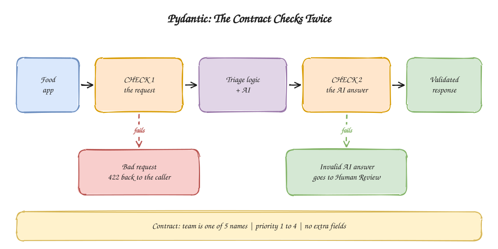

# Pydantic: The Contract

Diagram source: [Excalidraw](../02-diagrams/excalidraw/page-04-pydantic-the-contract.excalidraw) | draw.io: [python-production-engineering.drawio](../02-diagrams/drawio/python-production-engineering.drawio), page 04

## Context

Support Ops expected:

    category: payments   priority: 4       team: payments

The AI returned:

    category: payment    priority: High    team: payment team

A person can read that. The ticketing system cannot. There is no team called `payment team`, so 500 complaints went nowhere.

## Concept: a contract

Our promise: "Give me data in this format, and I will return data in this format."

- category: one of the allowed categories
- priority: a number from 1 to 4 (not "High", not "Urgent")
- team: one of the allowed teams

Pydantic turns that promise into code. Data that breaks it is rejected.

## Concept: we check twice

| Check | What | If it fails |
|-------|------|-------------|
| Check 1 | the request from the food app | 422 back to the caller. The caller must fix it |
| Check 2 | the answer from the AI | not the caller's fault, so we do not fail: the complaint goes to Human Review |

## Concept: never trust a model's output

An AI answer is input from another system, like any other input. It can be wrong, incomplete or in a different format. Validate it before you use it.

## In the lab

Part 07 writes the contract in `app/models.py` and proves it with `scripts/contract_check.py`: the AI answer from this story is rejected with 3 problems.

## Interview questions

1. What problem does Pydantic solve?
2. Pydantic checks data in two places in our service. Where, and what happens when each check fails?
3. Why should a model's output be treated as untrusted input?
4. What does `extra="forbid"` protect you from?

Previous: [FastAPI and Uvicorn: Turning Python Code into a Service](03-fastapi-and-uvicorn.md) | [Theory index](README.md) | Next: [Async: What Does Our Service Do While It Waits?](05-async.md)

## Keep learning

- YouTube: https://www.youtube.com/@BuildAutomateArchitect
- System Design playlist: https://www.youtube.com/playlist?list=PLeAHTLMwFYQ0
- Telegram: https://t.me/BuildAutomateArchitect
- Website: https://rahulchaubeyconsulting.com/
