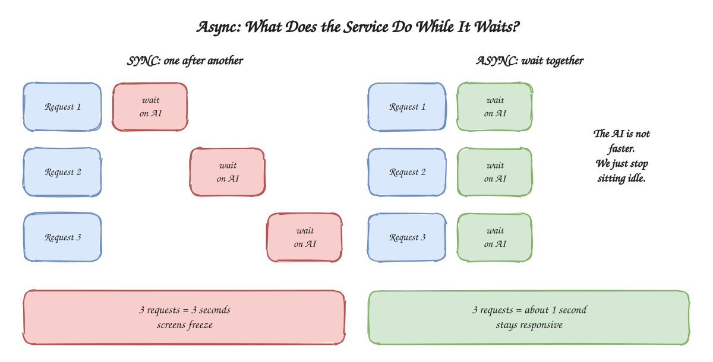

# Async: What Does Our Service Do While It Waits?

Diagram source: [Excalidraw](../02-diagrams/excalidraw/page-05-async.excalidraw) | draw.io: [python-production-engineering.drawio](../02-diagrams/drawio/python-production-engineering.drawio), pages 01b and 05

## Context

The Support Team Lead: "The AI takes about 1 second per complaint. 1000 complaints, one after another, is 16 minutes. Customers are waiting."

## Concept: most of the time is waiting

Our service sends the complaint to the AI and then waits. During that second, it does nothing.

    SYNC:   complaint 1 [wait....] complaint 2 [wait....] complaint 3 [wait....]   = 3 seconds
    ASYNC:  complaint 1 [wait....]
            complaint 2 [wait....]
            complaint 3 [wait....]                                               = about 1 second

The AI does not get faster. We just stop sitting idle.

## Concept: async alone is not magic

| Code | Result |
|------|--------|
| `async def` + `requests.post(...)` or `httpx.post(...)` | still blocks. Looks async, is not |
| `async def` + `await httpx.AsyncClient().post(...)` | waits without blocking |

## Concept: when the other system misbehaves

| Problem | Our answer |
|---------|------------|
| Slow | timeout (we wait 3 seconds at most) |
| Fails | retry carefully, with backoff |
| Still unavailable | fallback: Human Review |

A customer never waits forever, and a broken AI never crashes our service.

## In the lab

Part 08 races three versions with 10 complaints: one by one (10 s), the trap (10 s) and truly async (about 1 s). `app/triage.py` turns every AI failure into Human Review.

## Interview questions

1. Why does `async def` alone not make code asynchronous?
2. requests versus httpx.AsyncClient: what is the difference?
3. Why does every external call need a timeout?
4. Why can retries be dangerous?

Previous: [Pydantic: The Contract](04-pydantic-the-contract.md) | [Theory index](README.md) | Next: [Configuration and Secrets: Outside the Code](06-07-configuration-and-secrets.md)

## Keep learning

- YouTube: https://www.youtube.com/@BuildAutomateArchitect
- System Design playlist: https://www.youtube.com/playlist?list=PLeAHTLMwFYQ0
- Telegram: https://t.me/BuildAutomateArchitect
- Website: https://rahulchaubeyconsulting.com/
