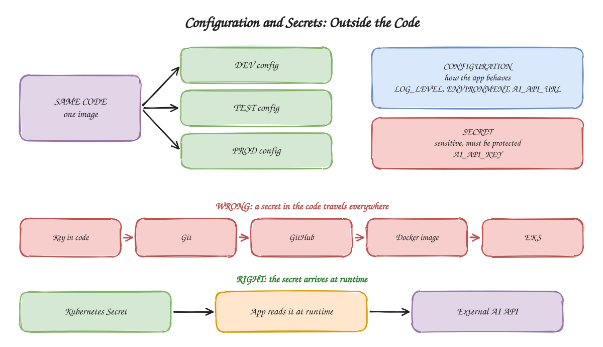

# Configuration and Secrets: Outside the Code

Diagram source: [Excalidraw](../02-diagrams/excalidraw/page-06-07-configuration-and-secrets.excalidraw) | draw.io: [python-production-engineering.drawio](../02-diagrams/drawio/python-production-engineering.drawio), pages 06 and 07

## Context

The Platform Engineer: "The AI URL is hardcoded. How do I point DEV and PROD to different AIs without changing code?"
The Security Head: "Your API key is in the Python file."

## Concept: configuration

Some values change between environments: `ENVIRONMENT`, `LOG_LEVEL`, `AI_API_URL`, `AI_TIMEOUT_SECONDS`.
They come from **environment variables**, not from the code. Same code, same image, different configuration.

    Build once, configure at runtime.

## Concept: a secret is different

`LOG_LEVEL=INFO` is configuration. `AI_API_KEY` is a **secret**. Both live outside the code, but a secret must also be protected.

A key written in the code travels everywhere the code goes:

    Key in code -> Git -> GitHub -> Docker image -> ECR -> EKS

The right way: the application **receives** the secret at runtime.

| Where | Configuration | Secret |
|-------|---------------|--------|
| On the workstation | `.env` file (never committed) | `.env` file (never committed) |
| In Docker | `-e NAME=value` | `-e AI_API_KEY=...` |
| On EKS | ConfigMap | Kubernetes Secret |

## Concept: fail fast

If the key is missing, the service refuses to start. Better a clear error now than a broken service at 2 AM.

## In the lab

Part 09 writes `app/config.py` with `pydantic-settings` and `SecretStr`. Part 10 proves `.env` is not inside the image. Part 11 creates the ConfigMap and the Secret.

## Interview questions

1. Configuration versus secrets: what is the difference?
2. Why should a secret never be inside a Docker image?
3. How does the same image run in DEV and PROD with different settings?
4. What does SecretStr protect you from?

Previous: [Async: What Does Our Service Do While It Waits?](05-async.md) | [Theory index](README.md) | Next: [Structured Logging and Health Checks](08-09-logging-and-health-checks.md)

## Keep learning

- YouTube: https://www.youtube.com/@BuildAutomateArchitect
- System Design playlist: https://www.youtube.com/playlist?list=PLeAHTLMwFYQ0
- Telegram: https://t.me/BuildAutomateArchitect
- Website: https://rahulchaubeyconsulting.com/
