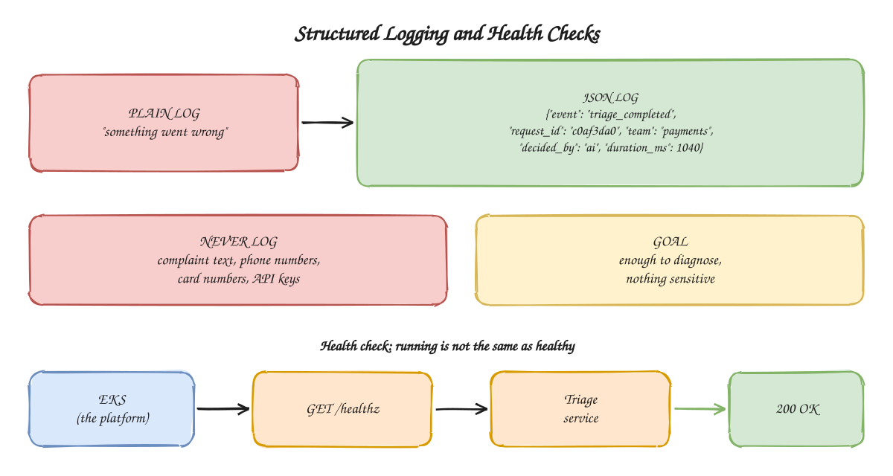

# Structured Logging and Health Checks

Diagram source: [Excalidraw](../02-diagrams/excalidraw/page-08-09-logging-and-health-checks.excalidraw) | draw.io: [python-production-engineering.drawio](../02-diagrams/drawio/python-production-engineering.drawio), pages 08 and 09

## Context

A customer calls: "My complaint was not processed." Thousands of requests went through the service that hour. Which one was theirs, and what happened to it?

## Concept: structured logs

    Plain text:   Something went wrong
    JSON:         {"event": "triage_completed", "request_id": "a843b7982c87",
                   "decided_by": "fallback: AI timed out", "duration_ms": 3004}

One JSON object per event. A logging system can search `request_id = a843b7982c87` and answer in seconds.
The same `request_id` goes back to the caller in the `X-Request-ID` header, so support can quote it.

## Concept: what never goes in a log

API keys, passwords, card numbers, phone numbers, addresses, and the complaint text itself.
We log `complaint_length` instead of the complaint.

Goal: enough information to diagnose the system, without exposing anyone.

## Concept: running is not healthy

A container can be running while the application inside is stuck. So the platform asks the service directly:

    GET /healthz  ->  200 {"status": "ok", "version": "1.2.0"}

Logging tells us what happened. Health checks tell the platform whether the service can be used right now.

## In the lab

Part 09 adds JSON logs and `/healthz`. Part 11 uses `/healthz` for the Kubernetes probes. Part 13 diagnoses six failures from the logs.

## Interview questions

1. What is structured logging, and why is it better than plain text?
2. What must never appear in logs?
3. Why do we need /healthz? What is the difference between running and healthy?
4. How do you find one customer's request among thousands?

Previous: [Configuration and Secrets: Outside the Code](06-07-configuration-and-secrets.md) | [Theory index](README.md) | Next: [Liveness vs Readiness](09b-liveness-vs-readiness.md)

## Keep learning

- YouTube: https://www.youtube.com/@BuildAutomateArchitect
- System Design playlist: https://www.youtube.com/playlist?list=PLeAHTLMwFYQ0
- Telegram: https://t.me/BuildAutomateArchitect
- Website: https://rahulchaubeyconsulting.com/
