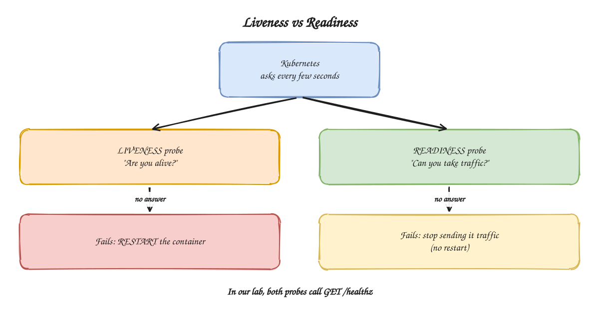

# Liveness vs Readiness

Diagram source: [Excalidraw](../02-diagrams/excalidraw/page-09b-liveness-vs-readiness.excalidraw) | draw.io: [python-production-engineering.drawio](../02-diagrams/drawio/python-production-engineering.drawio), page 09

## Context

On EKS, Kubernetes runs our pods. It needs to know two different things about each pod, and it acts differently on each.

## Concept: two questions

| Probe | Question | If it fails |
|-------|----------|-------------|
| **Liveness** | "Are you alive?" | Kubernetes **restarts** the container |
| **Readiness** | "Can you take traffic?" | Kubernetes **stops sending traffic** to the pod. No restart |

In our lab both probes call `GET /healthz`. Same endpoint, two different decisions.

## Concept: why readiness protects customers

During a rolling update, a new pod is started. Until its readiness probe passes, it receives no customers. If the new version is broken, it never becomes ready, the old pods keep serving, and customers notice nothing.

## In the lab

Part 11 adds both probes to the Deployment. Part 12 watches a rolling update with zero failed requests. Part 13 breaks the readiness probe on purpose.

## Interview questions

1. Liveness probe versus readiness probe?
2. A new version never becomes ready. What do customers see?
3. Why should a liveness probe not check other services like the AI?

Previous: [Structured Logging and Health Checks](08-09-logging-and-health-checks.md) | [Theory index](README.md) | Next: [What We Are Going to Build](10-what-we-are-going-to-build.md)

## Keep learning

- YouTube: https://www.youtube.com/@BuildAutomateArchitect
- System Design playlist: https://www.youtube.com/playlist?list=PLeAHTLMwFYQ0
- Telegram: https://t.me/BuildAutomateArchitect
- Website: https://rahulchaubeyconsulting.com/
