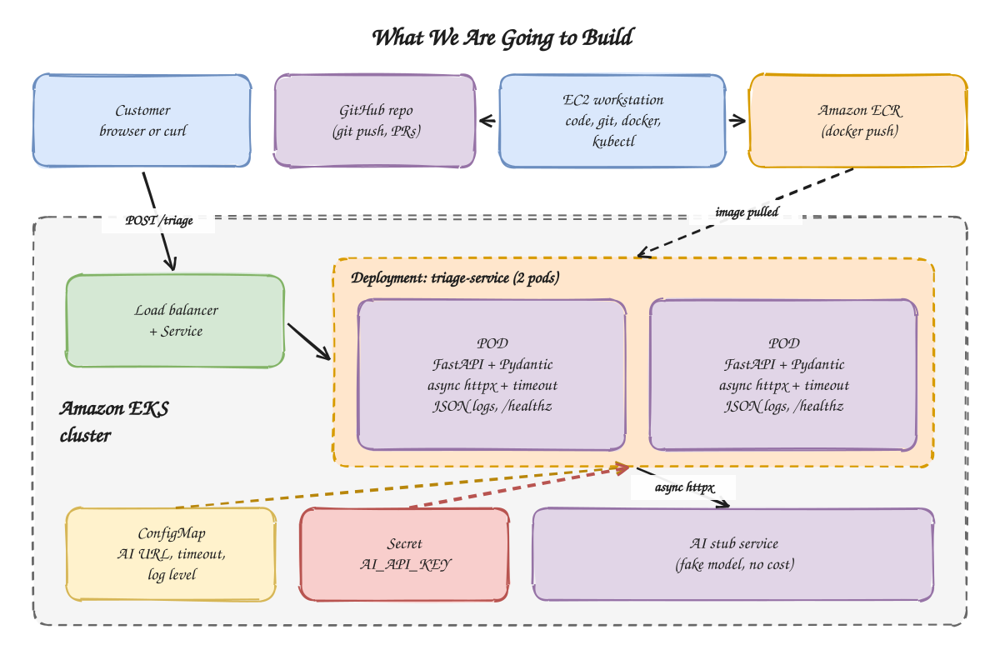

# What We Are Going to Build

Diagram source: [Excalidraw](../02-diagrams/excalidraw/00-what-we-are-going-to-build.excalidraw) | draw.io: [python-production-engineering.drawio](../02-diagrams/drawio/python-production-engineering.drawio), page 10 (and lab sheet L01 in triageops-lab.drawio)

## The architecture

| Component | Where | Job |
|-----------|-------|-----|
| EC2 workstation | AWS, your instance | write code, build images, run kubectl and eksctl |
| GitHub repository | GitHub | source code and pull requests |
| Amazon ECR | AWS | stores the Docker image |
| Amazon EKS cluster | AWS | runs the service |
| Service type LoadBalancer | EKS | public entry point |
| Deployment `triage`, 2 pods | EKS | FastAPI, Pydantic contract, async httpx with timeout, JSON logs |
| Deployment `ai-stub`, 1 pod | EKS | a fake AI model: no real key, no cost, can be slow or wrong on purpose |
| ConfigMap | EKS | ENVIRONMENT, LOG_LEVEL, AI_API_URL, AI_TIMEOUT_SECONDS |
| Secret | EKS | AI_API_KEY |
| Liveness and readiness probes | EKS | call GET /healthz |

## Endpoints

| Method | Path | Purpose |
|--------|------|---------|
| POST | /triage | send a complaint, get category, priority and team |
| GET | /healthz | is the service healthy? |
| GET | /docs | interactive API documentation |
| GET | / | the complaint web page (version 1.3.0) |

## The deployment flow

    Code on EC2 -> git push / pull request -> docker build -> push to ECR -> kubectl apply -> running on EKS

## How the four gates map to the build

| Gate | In the build |
|------|--------------|
| CONTRACT | Pydantic models, 422 for bad requests, Human Review for bad AI answers |
| ASYNC | httpx.AsyncClient with a timeout |
| SERVICE | ConfigMap, Secret, JSON logs, /healthz |
| SHIP | Docker, ECR, EKS, rolling update |

## Concept: public subnets in the lab

To keep the lab simple, the EKS nodes run in public subnets. In a real company they run in private subnets behind a NAT gateway, and only the load balancer is public.

## In the lab

Open [the lab map](../03-labs/README.md) and start with Part 00. The lab sheets in `triageops-lab.drawio` (L01 to L16) follow the same parts.

## Interview questions

1. Walk me through your deployment flow, from code to a running service.
2. Why is ai-stub a ClusterIP Service and triage a LoadBalancer?
3. Where does each of the four gates show up in the running system?

Previous: [Liveness vs Readiness](09b-liveness-vs-readiness.md) | [Theory index](README.md)

## Keep learning

- YouTube: https://www.youtube.com/@BuildAutomateArchitect
- System Design playlist: https://www.youtube.com/playlist?list=PLeAHTLMwFYQ0
- Telegram: https://t.me/BuildAutomateArchitect
- Website: https://rahulchaubeyconsulting.com/
